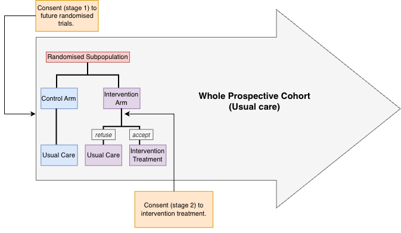

### Interval Censoring within TwiCs \| Methodology and Statistics for Behavioural, Biomedical and Social Science \| Present

I am currently completing an internship at the Data Science & Biostatistics Department at UMC Utrecht, where I am writing my master’s thesis with the clinical trials team. My research explores interval censored methods using a simulation that replicates Trials within Cohorts (TwiCs), with the potential to extend the analysis to real cancer patient data. I am excited to see what the results reveal and to keep growing my understanding of statistics within the medical field. The project is expected to be completed in May 2027. For readers unfamiliar with TwiCs, see @fig-Twics for a visual of such a trial.

{#fig-Twics width="70%" fig-align="center" fig-pos="H"}

### Final Year Bachlors Thesis \| Glasgow University \| 2025 \| First-Class Grade

I analysed real-world SEPA wastewater data to investigate flow and ammonia measurements in the context of wastewater-based epidemiology, independently sourcing and integrating supplementary rainfall data to strengthen the statistical analysis. Using R and Excel, I identified trends and patterns in the data and produced a comprehensive final report and presentation. Through this project, I developed strong skills in statistical analysis, critical thinking, and scientific communication, along with applied insight into medical and environmental statistics.
